<h1 align="center">Hi there, I'm Saurabh Kumar 👋</h1>

<h3 align="center">AI/ML Engineer in the making — building things that actually work, not just demos</h3>

  

  
  
  
  

---

### 🧑‍💻 About Me

- 🤖 Currently deep in **AI & Machine Learning**, building projects with real-world impact
- 🧩 Practicing **DSA** on LeetCode and GeeksforGeeks
- 📄 **IEEE-published author**
- 🛠️ Comfortable across the stack — from model training to shipping a working API
- 📫 Open to collaborating on AI/ML and full-stack projects — reach out on LinkedIn!

---

### 🛠️ Languages & Tools

  
  
  
  
  
  
  
  
  
  
  
  
  
  
  

---

### 📊 GitHub Stats

  

  

---
